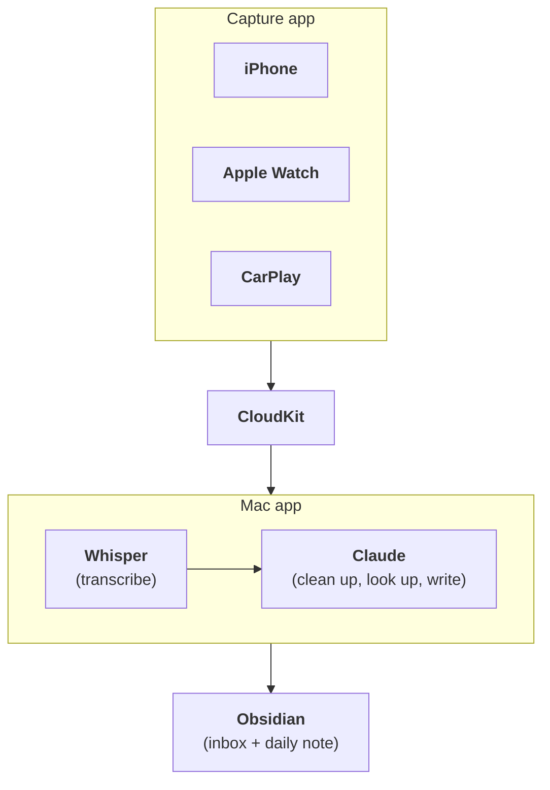
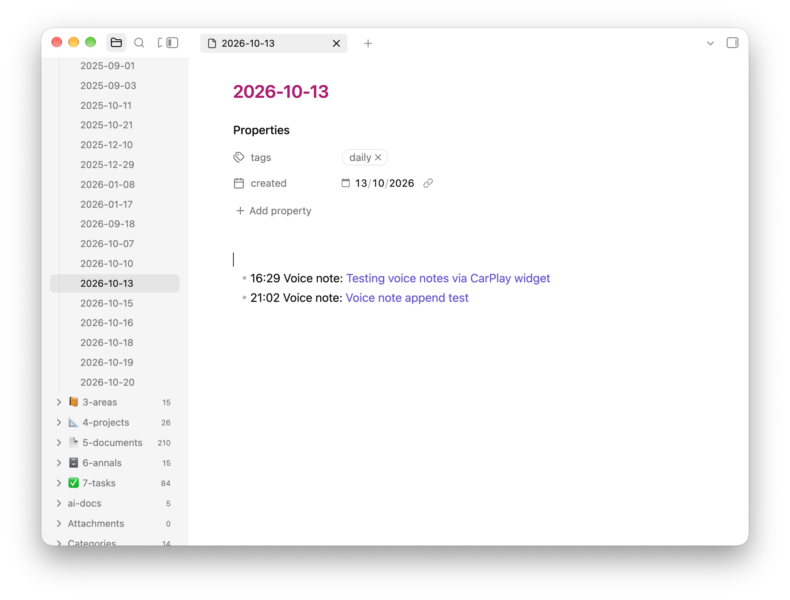
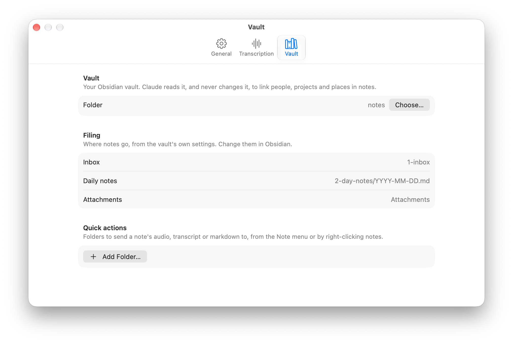
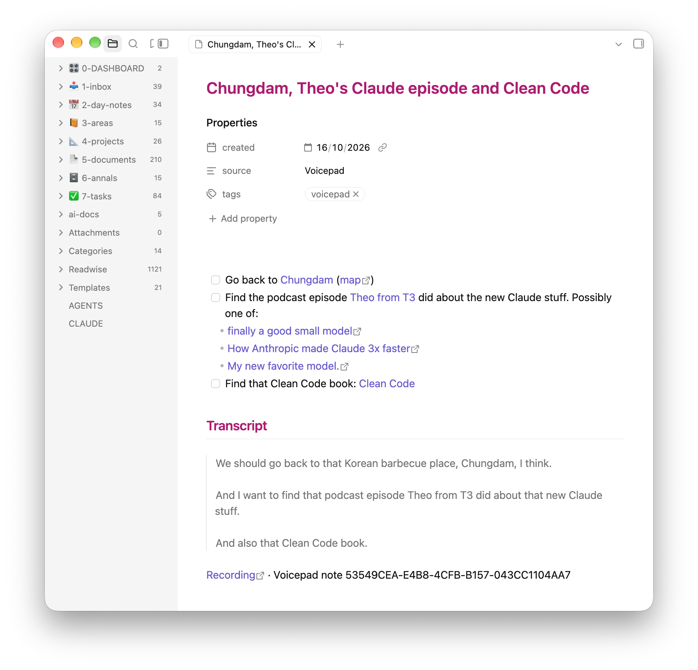

<IntroParagraph>I have most of my good ideas in the car. Or on a walk. Or at 1am when I should be asleep. I've always been like this.</IntroParagraph>

None of these places make it convenient to type, so for years I've yearned for some way to ramble into a device and have that magically appear in whatever *inbox* I'm currently using in a form that can be sensibly processed later.

Recently, the best option has been a janky combination of [Obsidian](https://obsidian.md/), [Drafts](https://getdrafts.com/) and Apple [Voice Memos](https://apps.apple.com/us/app/voice-memos/id1069512134). **Which has never worked well.**

So I've just built **Voicepad**. It lets me ramble into my **iPhone**, **Apple Watch** or **CarPlay**, and the results are sane markdown documents in my **Obsidian inbox**. By *sane* I mean that they are properly formatted and structured, have a sensible title and frontmatter, include appropriate wikilinks to other things in Obsidian and most importantly... my insane ramblings have been turned into something I can actually work with when I come to process my inbox.

I had a look at what already exists before building this and basically drew a blank. Voice Memos syncs nicely to the Mac and works on my watch without a phone, but it isn't available in CarPlay. [Auto Memo Recorder](https://apps.apple.com/us/app/auto-memo-recorder/id6742404093) does record in CarPlay, but has no proper Mac app and is janky as fuck. I couldn't find a single open-source app in this space that records in CarPlay.

## What is Voicepad?

There are two apps:

- **The capture app** runs on my iPhone, Apple Watch and in CarPlay. Its only job is to record quickly and easily without losing anything.
- **The Mac app** receives the recordings, transcribes them, hands the transcript to Claude for some processing and writes the result into my Obsidian vault.

They talk to each other via [CloudKit](https://developer.apple.com/icloud/cloudkit/) so I don't need to run any sort of sync server.



## Capturing

My priorities here are:

1. Fast and frictionless capture anywhere.
2. Dependable capture and sync.

Everything else is in the Mac app's domain.

### On the phone

<BasicImage
  src="/src/assets/articles/2026-10-20-voicepad-ios-app.png"
  alt="The Voicepad iPhone app: a big red record button above a list of notes, each with a play button, its length and an icon for the device it came from"
  width={300}
  caption="The iPhone app, which I rarely open"
/>

The iOS app is mostly a big red button and a list of what I've recorded. Besides the phone app, I can also start recordings from:

- A Lock Screen or Home Screen widget
- A button in Control Centre
- The Action button
- Siri

All of these run the same three actions under the hood: **start**, **stop** and **add to my last note**. While recording, a Live Activity shows on the Lock Screen and in the Dynamic Island.

### In the car

This is the thing I cared about most, and was least sure I could build, because Apple only allows recording in CarPlay if it's a "voice-based conversational" app, and you have to apply for permission (an *entitlement*) to make one.

In the car it's a voice-first screen: I say "new note", "add to my last note" or "stop recording" and it answers out loud, with two big buttons (a plus to add to my last note and a red disc to start or stop) for when it can't hear me over the road.

### On the watch

The watch records on its own regardless of whether it's in range of my phone and syncs to the phone whenever it next connects. Much like with the phone, I can start recordings via the app itself, a *complication* or Siri.

<Grid columns={3}>


</Grid>

### Appending

The car is mostly why **appending** exists. On a long drive I'll often have a thought, go back to my music and then think of something else related a few minutes later. The rules here are deliberately dumb:

- You can only append to **the most recent note**.
- Only **on the same device**.
- Only for **45 minutes** after it last ended.

## Sync

Syncing happens via CloudKit, in my own iCloud database. The unit of sync is a **segment**, not a note. Every recording makes a segment and every "add to my last note" makes another one, so a note is the set of segments that share a note ID. Segments are written once and never changed, so I never have to edit an audio file in place (which you can't do with `.m4a` anyway) and nothing can conflict during sync.

Each segment is one CloudKit record carrying:

| Field | Example | What it is |
|---|---|---|
| Note ID | `810CBAD7-…` | Which note it belongs to |
| Sequence | `0` | Its position in the note: 0, 1, 2… |
| Recorded at | `2026-10-15 22:49:01` | When it started |
| Duration | `28s` | How long it is |
| Source | `watch` | Phone, watch, CarPlay or Mac |
| Audio | `E47006CD-….m4a` | The recording itself: mono AAC, about half a megabyte a minute |
| Recording details | `{"trigger": "watchComplication", …}` | A blob of JSON: what started it (widget, Siri, car voice, watch complication…), which microphone, how it ended, app version, device, time zone |

<Callout>
The last field is JSON in a single text column so I can add to it without needing to change CloudKit's schema. It's mostly there for debugging, but the Mac also uses the time zone to file each note under the right day for wherever I recorded it.
</Callout>

<BasicImage
  src="/src/assets/articles/2026-10-20-voicepad-mac-segment-details.png"
  alt="The Mac app's details for a two-part note recorded on my Apple Watch. Each part lists when it was recorded and synced, its length and audio file, then the recording details: app version, device, how it ended, which microphone, system version, time zone and what triggered it"
  width={524}
  caption="The two segments of a note from my watch. Everything from appVersion down is the recording details JSON"
/>

The phone uploads as soon as I hit stop, even if I lock it straight away. The Mac gets a push from CloudKit and also checks every few minutes, because pushes are best-effort. **Sync is one-way** from the phone to the Mac. The only thing that ever goes back the other way is a deletion (for when I've recorded something by accident).

## On the Mac

The Mac app is a menu bar app with a main window that looks a lot like Finder. There's a sidebar with an inbox and the notes grouped by status (Waiting, Processed, Failed) and by device (iPhone, CarPlay, Apple Watch, Mac), a list of notes, and an inspector on the right with a player and three tabs:

- The **transcript**
- The AI-generated **markdown note**
- The **details** (where it came from, and a log of everything that's happened to it)

<Tabs>
<TabItem label="Transcript">


</TabItem>
<TabItem label="Markdown">


</TabItem>
<TabItem label="Details">


</TabItem>
</Tabs>

Right-clicking a note lets me process it now, run the clean-up or the note again, reveal its files in Finder, copy the audio into my vault or bin it. That's about it, because **this UI only really exists for helping me deal with anything weird that happened**. If everything's working as intended, I rarely need to use this interface because the final notes are written directly to my Obsidian inbox.


### What happens during processing

When the Mac app receives a new note via CloudKit sync, it waits for half an hour or so in case I append more segments to it. After that, it processes the note like this:

1. **Join** the segments into one audio file.
2. Locally **transcribe** the audio with [WhisperKit](https://github.com/argmaxinc/argmax-oss-swift).
3. Lightly **tidy the transcript** by adding line breaks at pauses, removing some of Whisper's junk words and applying a simple find/replace for certain words and phrases.
4. Properly **clean up** the transcript using Claude, and **look up** anything I asked it to find (more below).
5. **Generate a markdown document** from the transcript using Claude.
6. **File** that in my Obsidian inbox and add a link to that day's daily note.

<BasicImage
  src="/src/assets/articles/2026-10-20-voicepad-mac-log.png"
  alt="A note's log in the Mac app: synced parts 1 and 2 from iPhone, processing started, transcribed with Whisper, AI clean-up with Sonnet in 5 seconds, AI note with Opus in 10 seconds over 4 turns, added to the inbox, and linked from the daily note"
  width={388}
  caption="One note's log, step by step"
/>




Each step leaves its output in the note's own folder and never edits what came before, so I can rerun any step without redoing the earlier ones. Here's what a single note's folder looks like on disk, after processing:

```tree title="~/Library/Application Support/Voicepad/Notes/"
53549CEA-…/
├── note.json            # its parts, when they arrived, its status and a log
├── audio.m4a            # the segments joined
├── transcript.json      # Whisper's output: every word with its timing and confidence
├── transcript.txt       # the readable transcript (replaced by Claude's clean-up)
├── note.md              # the markdown note
└── ai/
    ├── clean-up.json         # prompt as sent, model, answer, how long it took
    ├── clean-up.trace.ndjson # Claude's full trace
    ├── look-up.json
    ├── look-up.trace.ndjson
    ├── write-note.json
    └── write-note.trace.ndjson
```

When a note comes out oddly, the `ai/` folder shows exactly what Claude was sent and what it did, so I can see whether it linked a person because it read their note or because it guessed.

## The AI bit

The Mac app doesn't use the Claude API. Instead, it runs the `claude` command-line tool (which uses my normal Claude subscription). Each call looks roughly like this:

```sh
claude --print \
  --model opus --effort medium \
  --system-prompt "<the step's prompt>" \
  --json-schema "<the step's schema>" \
  --tools "Read,Glob,Grep" \
  --add-dir ~/notes \
  --settings '{"permissions":{"defaultMode":"dontAsk","allow":["Read(//Users/danny/notes/**)", …]}}' \
  --setting-sources "" \
  --strict-mcp-config \
  --no-session-persistence \
  < input.md
```

The `--setting-sources ""` and `--strict-mcp-config` flags mean none of my own Claude Code settings, hooks, plugins or MCP servers load, and `--json-schema` makes Claude answer in a fixed shape which the app can decode.

If I'm offline and Claude can't be reached, the note keeps Whisper's transcript and the AI steps try again ten minutes later or when I spot the error in the Mac app.

### Two outputs, kept apart

Claude makes two things from each recording:

1. **The cleaned transcript** is still a *transcript*. Spelling, punctuation and misheard words are fixed, filler is removed, etc. But this should still be an actual transcript of what I said.
2. **The note** is a *new thing*, generated from the transcript and context from my vault. It shapes my words into something I can act on when processing my inbox, including things like:
    - Rewritten with context from my vault, with the context at the top.
    - Afterthoughts move to where they belong.
    - Tasks become a checklist.
    - Phrases like "next Wednesday" become actual dates.
    - Mentions of people, projects and *things* are wikilinked properly.
    - Mentions of places, books, objects, events, online resources and the like are enriched with their proper names, URLs, ISBNs etc – all looked up via the web.

What separates the **transcript** from the **note** is how sure Claude is. The transcript only gets changes that are clearly *corrections*, so if Claude isn't sure what I said, it leaves Whisper's version alone. When Whisper invents words over road noise, the **clean-up** leaves them as heard, while the **note generation** might leave them out and say that bit was unclear. Basically... anything that changes meaning belongs in the note.


### Prompts as files

Each AI **step** is a folder of plain files on disk which is read on every run. Currently there are three:

```tree
Prompts/
├── clean-up/
│   ├── PROMPT.md      # frontmatter (model, effort, tools) + the system prompt
│   ├── input.md       # the message, with {{placeholders}} for the note
│   └── schema.json    # the shape the answer must have
├── look-up/
│   ├── PROMPT.md
│   ├── input.md
│   └── schema.json
└── write-note/
    ├── PROMPT.md
    ├── input.md
    └── schema.json
```

I copied the format from Claude Code's own [subagents](https://code.claude.com/docs/en/sub-agents). Here's the top of the **clean-up** step:

```markdown title="Prompts/clean-up/PROMPT.md"
---
name: clean-up
description: Cleans up Whisper's transcript of a voice note, keeping it a transcript of what was said, and lists anything to look up on the web.
model: sonnet
effort: low
tools:
vaultNames: 3-areas, 4-projects, 5-documents
---

You clean up transcripts of Danny's voice notes. Danny records them on his phone,
watch, Mac or in the car, and Whisper transcribes them. Your result replaces
Whisper's text as the note's transcript, so it must still be a faithful record
of what Danny said, only easier to read.

…

Never:

- Reorder, summarise, restructure, shorten or add anything. Afterthoughts stay
  where Danny said them.
- Drop a sentence because it is garbled or makes little sense. Keep it as it was
  heard, lightly punctuated. Whisper invents words over loud noise, such as an
  open car window, but you can't tell which, so leave them.
- Change a word you aren't sure of. A plausible guess is worse than a faithful
  mistake, because Danny can hear the audio and you can't.
- Tidy away swearing or Danny's way of speaking.
```

And its `input.md`, which is what gets sent as the message:

```markdown title="Prompts/clean-up/input.md"
Recorded {{recordedAt}} on {{device}}, {{duration}} long.

Words Whisper was least sure of: {{uncertainWords}}

<transcript>
{{transcript}}
</transcript>
```

The placeholders are where "boring" code helps the model by cheaply working out things Claude would otherwise have to go and find:

- `{{recordedAt}}` is "Friday, 16 October 2026 at 1:12 (Europe/London)", with the weekday, so "next Wednesday" can be worked out.
- `{{uncertainWords}}` comes from Whisper's confidence in each word, so these are the words it was most likely guessing at.
- `{{vaultNames}}` is the names of every note in the folders the step lists (people, places, projects), so Sonnet can spell "Chungdam" correctly without searching for it.
- `{{vocabulary}}` is a list of my own jargon from the app's settings.


The `schema.json` for the **clean-up** step looks like this:

```json
{
  "type": "object",
  "properties": {
    "transcript": {
      "type": "string",
      "description": "The cleaned transcript, in paragraphs separated by blank lines."
    },
    "lookUps": {
      "type": "array",
      "items": { "type": "string" },
      "description": "Things Danny wants found or identified that need a web search, each described for searching. Usually empty."
    }
  },
  "required": ["transcript", "lookUps"],
  "additionalProperties": false
}
```

### The three steps

| Step         | Model              | Tools                | Takes                               |
| ------------ | ------------------ | -------------------- | ----------------------------------- |
| `clean-up`   | Sonnet, low effort | None                 | 2–6 seconds                         |
| `look-up`    | Opus               | Web search and fetch | ~35 seconds, and only when needed   |
| `write-note` | Opus               | Read my vault        | 3–15 seconds, longer for long notes |

`clean-up` does the **transcript**. Since it's reading every word anyway, it also lists anything I've asked to be found: a book, a podcast episode, a restaurant. Most notes have nothing here.

`look-up` only runs when there's something on that list. It searches the web and returns one result when it's sure, a few candidates when it isn't, and nothing when what I said was too vague. *(I tried Sonnet here first. It was faster, but it kept finding sites that aggregate other sites rather than the actual thing.)*

`write-note` gets the cleaned transcript and whatever `look-up` found, reads my vault for context and writes the note. Its prompt describes how my vault is laid out and when and how to link proper nouns (`[[Andy Bracegirdle]]` is fine even if there's no note for him yet, but `[[Andy]]` isn't because it's too ambiguous).


### Security & privacy

Giving an AI agent read access to my whole Obsidian vault *and* to the web feels a bit risky, so this is set up such that **a step can either read files OR use the web. Never both.**

So `look-up` can search the web but never sees the vault (only the transcript), while `write-note` can read the vault but can't reach the web. Also: nothing can write *anything* – only Voicepad's own code writes files. The app refuses to run any step which asks for both kinds of tool, or for any tool outside a short list.



## Processing: an example

Here's an example from start to finish, based on a 22-second recording I mumbled into my phone at about 1am...

What I said, as Whisper transcribed it:

> we should go back to that korean barbecue place uh chundam i think uh and i want to find that podcast episode theo from t3 did uh about uh about that new claude stuff uh and also that clean code
>
> book

After the `clean-up` step:

> We should go back to that Korean barbecue place, Chungdam, I think.
>
> And I want to find that podcast episode Theo from T3 did about that new Claude stuff.
>
> And also that Clean Code book.

…plus a list of things to look up:

```json
{
  "lookUps": [
    "Chungdam Korean BBQ, a Korean barbecue restaurant Danny wants to go back to, probably in London",
    "Podcast episode by Theo (t3.gg, Theo Browne) about the new Claude models/stuff, recent as of October 2026"
  ]
}
```

`look-up` found the restaurant on Google Maps, but couldn't be sure which of Theo's videos I meant, so it came back with three. `write-note` then found my notes on Chungdam, Theo and Clean Code in the vault and linked them. Here's what landed in my inbox:

```markdown title="Chungdam, Theo's Claude episode and Clean Code.md"
---
created: 2026-10-16
source: Voicepad
tags:
  - voicepad
---

- [ ] Go back to [[Chungdam Korean BBQ|Chungdam]] ([map](https://www.google.com/maps/search/?api=1&query=Chungdam%2C%2035-36%20Greek%20Street%2C%20Soho%2C%20London%20W1D%205DL))
- [ ] Find the podcast episode [[Theo Browne T3|Theo from T3]] did about the new Claude stuff. Possibly one of:
  - [finally a good small model](https://www.youtube.com/watch?v=38_6C0dkKmU)
  - [How Anthropic made Claude 3x faster](https://www.youtube.com/watch?v=FsDUOUV9Vs8)
  - [My new favorite model.](https://www.youtube.com/watch?v=jgGyX7MPPVg)
- [ ] Find that Clean Code book: [[Clean Code A Handbook of Agile Software Craftsmanship (Robert C. Martin Series)|Clean Code]]

## Transcript

> We should go back to that Korean barbecue place, Chungdam, I think.
>
> And I want to find that podcast episode Theo from T3 did about that new Claude stuff.
>
> And also that Clean Code book.

[Recording](file:///Users/danny/Library/Application%20Support/Voicepad/Notes/53549CEA-E4B8-4CFB-B157-043CC1104AA7/audio.m4a) · Voicepad note 53549CEA-E4B8-4CFB-B157-043CC1104AA7
```

This whole run took 45 seconds: 2 to transcribe, 3 for `clean-up`, 31 for `look-up` searching the web and 7 for `write-note`.



Then a line goes on the end of that day's daily note (the same one [Claude logs to](/notes/claude-daily-log)): `- 01:12 Voice note: [[Chungdam, Theo's Claude episode and Clean Code]]`.

Here's another little example. When I said:

> Okay, this is actually just a test note, but let's pretend it's a real one. When I get to Longmore Camp tomorrow, I need to speak to Ryan Currid about cats.

I ended up with this note:

```markdown
Test note, but treat it as a real one.

- [ ] Speak to [[Ryan Currid]] about cats when I get to [[Longmore Camp]] tomorrow (Saturday 17 October)
```

"Tomorrow" got turned into a date, Ryan got wikilinked and the task was turned into a checkbox for me.

## So what's next

Mostly **tweaking** based on actual usage. That said, there are a few features I might consider adding:

- **A global hotkey on the Mac** that records straight into a new note without opening the window.
- **A cheap classifier step** that asks questions like "does this name people?" and uses the answers to pick which bits of prompt to send.
- **A final check** of the note against the transcript, looking for anything wrong or made up.
- **A cleaned-up copy of the audio** for listening back, with some of the car noise taken out.

I'll post an update once I've used this for a while in anger.
