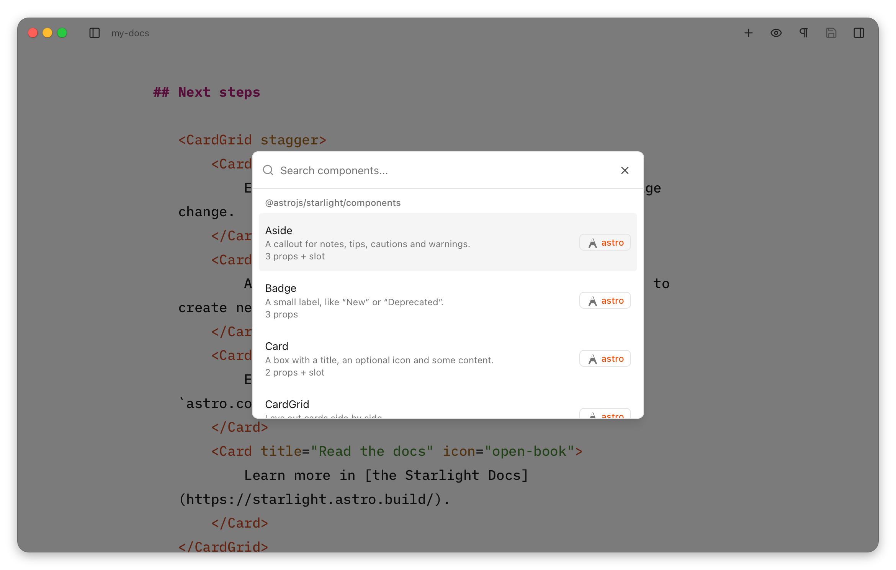

import releaseVideo from '@assets/articles/2026-11-10-astro-editor-1-1.mp4'
import releasePoster from '@assets/articles/2026-11-10-astro-editor-1-1-poster.jpg'

I just released [Astro Editor](https://astroeditor.danny.is/) 1.1.0, the biggest release since 1.0.0 (a year ago in November 2025)! This release changes how the app understands Astro projects, turns the MDX component builder into a proper interactive form, and can (if you want it to) write the `import` code your MDX files need. There's also a *loooooong* [list of fixes](https://astroeditor.danny.is/releases/v1.1.0/). Here's a quick video showing some of the new features.

<video src={releaseVideo} poster={releasePoster.src} controls playsinline preload="metadata" width="1920" height="1080"></video>

When I [wrote about Astro Editor 1.0](/writing/introducing-astro-editor) in January, reworking how project settings are handled was the only [**really meaty thing**](https://github.com/dannysmith/astro-editor/issues/82) I still wanted to do. In April I [noted](/notes/2026-04-02-slop-is-not-necessarily-the) that this is important because it's:

> entirely about reducing both cognitive and technical complexity.

It's taken a while, but I'm super happy to finally get this out. So what's new in Astro Editor?

## Project settings

The whole approach to understanding and managing project settings, field mappings, path overrides and the like has been rewritten with two objectives:

1. Using the information already available from the Astro project itself.
2. Making it **much easier** for you to understand and tweak how <abbr title="Astro Editor">AE</abbr> interacts with your projects.

### How it worked before

Astro Editor 1.0 assumed every collection lived in `src/content/<collection-name>`. If your site was set up differently, you told it so in two tabs in Preferences, with overrides for the project and again for each collection. Each setting fell back through a chain: collection override, then project setting, then default.


That was fine for sites laid out the way Astro's docs suggest, but it didn't hold up well beyond them. A collection whose files lived somewhere else simply didn't appear, with no explanation. Nothing showed what Astro Editor had guessed, so you couldn't tell a value it had worked out from one you'd set. Projects were matched by the `name` in their `package.json`, so two copies of the same site shared settings. And the collection-level folder overrides were saved but not consistently used.

Moreover, the settings panes and docs did a terrible job of explaining how the various overrides interacted with one another, and there was no single mental model for how this stuff should work either **for the user** or in the underlying code. This increasingly felt like the root cause of all sorts of little bug reports and complexities when thinking about new features, and I'm *certain* that it caused many people with slightly weird project setups to try AE and give up.

### The new mental model

The idea behind the rework is that Astro Editor should **read your project rather than ask you about it**. Your content config already says where each collection's files are and what its frontmatter looks like, so the app should use that, and only ask about the things it **can't** know, while still allowing you to override settings where you want to.

So there are two kinds of setting:

1. **What Astro says.** An *intelligent* read of your [`content.config.ts`](https://docs.astro.build/en/guides/content-collections/), generated JSON schemas and a few other key files yields an **awful lot** of useful stuff besides the frontmatter schemas. We should use this as our "default config" and read it from your project's codebase every time it's scanned. We should never save this kind of info ourselves.
2. **What you chose.** When our read of your project has got something wrong or can't find what it needs, you should be able to fix it, and this should be saved in AE's settings for the project.

Everything about an Astro site you've opened now lives in its own Project Settings panel. AE's global Preferences are now purely about configuring the app itself (theme, IDE etc).

Reading loaders properly fixes the "unusual structure" problem. Astro Editor now reads [`glob()`](https://docs.astro.build/en/reference/content-loader-reference/#glob-loader) the way Astro does, including its `base` and `pattern`, so a config like this works:

```ts title="src/content.config.ts"
const blog = defineCollection({
  loader: glob({ base: './content/blog', pattern: '**/[^_]*.md' }),
  schema: z.object({
    // ...
  }),
})
```

Astro Editor 1.0 would have looked for `src/content/blog`, not found it, and left the collection out. Now it finds `content/blog`, and files the pattern leaves out (like `_draft.md`) are hidden, or shown dimmed if you'd rather see them. [Starlight](https://starlight.astro.build/)'s `docsLoader()` and legacy collections work too.

This also means we can be more intelligent about a few other settings: if a loader's `pattern` only includes `.md` files then we don't need to worry about which format should be used for new files there – they should always be markdown.

And since we already parse a project's `package.json`, its content directory structure and its content files, we can take a very good guess at things like:

- Is this a Starlight project?
- Where are this collection's assets usually located?
- What's the file-naming convention for this collection?
- How are the files in this collection ordered?

<Callout type="default" emoji="💡">
It'd be **very easy** to go too far and end up coupling AE to things that shouldn't be its business. This is why I chose not to *rely* on anything in `package.json`, or try to read path aliases from `tsconfig.json` and suchlike.
</Callout>

One of my favourite little features in AE 1.1 is a side-effect of this *"use what we can reliably read from the project first"* mentality. It now uses the site's favicon in a few places (only if we can easily read it, of course).

### The Project Settings panel

[Project Settings](https://astroeditor.danny.is/project-settings/) is its own thing now and shows what Astro Editor found for the current project.


The main *Project* pane only contains settings for MDX components (which now supports multiple folders) and images, with an option to change the content folder if needed. Any issues reading a project's data are shown at the top. The sidebar lists the content collections AE can edit at the top with other collections below.

Collections compatible with Astro Editor show the file and loader they were read from and have settings to manually override the content folder path and set a default sort order for the sidebar. There's also a new toggle to show markdown & MDX files which would usually be ignored.


The setting for new file naming is new and lets you choose a pattern to use for the filename when creating files in the app. Right now it only supports a fairly simple syntax, but I'll undoubtedly end up allowing for more complex patterns in here sometime soon.

Collection settings also allow you to configure the "special" fields (title, description, date and draft) and images and links. Every value says where it came from, so **Detected: `title`** means it found a field of the right name and type in the schema. **Default** and **Global preference** mean just what they say. Once you change something it's marked **Set by you**, with a button to reset it. So you can see what's been worked out and what's been explicitly chosen by you.


Each collection's page also shows its schema **as Astro Editor reads it**, with how the frontmatter panel will show each field. Problems show up here and in the file list, like a folder that doesn't exist or a schema that needs [`astro sync`](https://docs.astro.build/en/reference/cli-reference/#astro-sync), along with what to do about them.


Most folks will never need to look at this, but if AE is struggling to understand your collection's schema or something is behaving weirdly, this view should help you understand what's going on.

The sidebar also shows two kinds of collections whose content can't be edited in Astro Editor. JSON and YAML collections look like this:


These **are parsed** by Astro Editor because they're often referenced in the frontmatter of markdown/MDX content collections, in which case they're shown as dropdowns in the frontmatter sidebar. Showing these in the Project Settings makes it easier to understand any problems with how AE understands them.

Other content collections are also shown here even if AE doesn't understand their `loader`. You can see the schema as usual, and if you know they represent markdown/MDX files on disk you can select a content folder and they'll work like any other collection. This website has two collections which use a custom `atprotoLoader()` to get their content from my [<abbr title="Personal Data Server">PDS</abbr>](/notes/2026-06-04-this-site-on-atproto), including [my books](/writing/books-on-bookhive).


Together, I'm hoping all this makes it much easier to configure Astro Editor for a new project, and easier to "debug" when it behaves in unexpected ways.

### The project list

It's never been easy to switch between projects – you had to choose the directory in a file picker. This is nuts because under the hood, the app's always kept a registry of the projects you've previously opened.

So <kbd>⇧⌘O</kbd> now [shows every project](https://astroeditor.danny.is/file-management/overview/#opening-a-project) you've opened in a fast switcher which also lets you remove old projects from AE.


Projects are now remembered by their path instead of their name, which is much more sensible. If you move a project on disk the picker will show it as missing and let you point it at the new location easily.

## The MDX component builder

The second **Big Feature** in this release is a revamped MDX Component Builder.

### How it worked before

Pressing <kbd>⌘/</kbd> in an MDX file showed a list of the components in your configured MDX folder. In 1.0, picking one showed its props and their types, which you could toggle on and off before inserting it with every prop empty.


You then filled in the values by hand in the editor, which meant knowing what each one accepted and how to write it in MDX. For a `Callout` with a title that's easy; for a component that takes an image, date or `enum` it was awkward.

### How it works now

Picking a component now gives you a form, with a field for each prop built from its type. Here's a component from the [docs](https://astroeditor.danny.is/editor/mdx-components/):

```astro title="src/components/mdx/BookCard.astro"
---
/**
 * A book with its cover and your rating, for reading lists and recommendations.
 */
import type { ImageMetadata } from 'astro'
import type { CollectionEntry } from 'astro:content'

interface Props {
  /** The book's title */
  title: string
  author: string
  cover: ImageMetadata
  format?: 'hardback' | 'paperback' | 'ebook' | 'audiobook'
  /** Out of five */
  rating?: number
  finished?: Date
  favourite: boolean
  spoilers?: boolean
  tags?: string[]
  /** Your full review, linked from the card */
  review?: CollectionEntry<'books'>
}

const { format = 'paperback' } = Astro.props
---
```

And here's the form it gets in the MDX builder:


This behaves much as you'd expect: strings get text boxes, booleans get switches, dates get date pickers, unions of strings get dropdowns. Etc. Anything it can't work out just gets a text box.

Doc comments are shown as help text, defaults are shown beside each prop, and required props are marked as such. The builder also writes each value in the right MDX syntax (eg. `rating={5}`, `finished={new Date('2026-01-15')}`), so you don't have to do that after in a coding tool.

These props are inferred from Astro, React, Vue and Svelte components directly from their source without actually executing or walking any code. So complex or weird props will probably still need filling in by hand in the editor. As in the frontmatter panel:

- Props using Astro's [`ImageMetadata`](https://docs.astro.build/en/guides/images/) type will show an image picker which works the same way the frontmatter panel's image picker does.
- Props using Astro's [`CollectionEntry`](https://docs.astro.build/en/reference/modules/astro-content/#collectionentry) type will attempt to show a dropdown of the relevant collection's items.

### Starlight components

If your site uses Starlight, the builder also offers Starlight's own components, like `Tabs`, `Card` and `Steps`, with their contents filled in correctly.



These ship as part of Astro Editor itself rather than being read from your project's version of Starlight.

## Automatically adding imports

Every component used in an MDX file has to be imported at the top, between the frontmatter and the content. Astro Editor hides those lines while you write, and until now it never touched them because they are [unquestionably **coder mode stuff**](https://astroeditor.danny.is/getting-started/philosophy/).

But if you're writing in AE with your dev server running and your content open in a browser, adding a new MDX component via the builder causes the page to error. Which means you have to open your code editor and add the required import after the frontmatter. Which **is incredibly annoying if you're just trying to write a thing**. So in 1.1 the builder can attempt to [add the imports for you](https://astroeditor.danny.is/editor/mdx-components/#adding-imports).

This is the first feature that edges Astro Editor towards "coder mode" stuff (it writes code in your project which you never see in AE). So the imports it writes should be considered a **best attempt** and AE is deliberately careful here: when it isn't sure what to write, it leaves well alone. And this is off by default and marked experimental. If your site already imports MDX components for you (I use [astro-auto-import](/notes/less-painful-editing-in-astro) on this one), leave it off.

With the feature switched on, the MDX builder adds the component's import when it inserts the MDX tag: it copies how your other MDX files already import the component, so aliases like `@components/mdx` and index files get used without Astro Editor having to understand your `tsconfig.json`. If nothing imports it yet, it uses a relative path. Quotes and semicolons match the rest of the file, and nothing else in those lines should change. That said... **don't blame AE if it occasionally mangles the code below your frontmatter!**

### MDX component props which need imports

Some MDX components have props which require their own imports. The image prop mentioned above gets an image picker in the MDX builder which copies the image into your project but needs importing into your MDX file to use it. A prop taking a collection entry gets a searchable list of that collection's entries, but needs loading with [`getEntry`](https://docs.astro.build/en/reference/modules/astro-content/#getentry) in the file.

The auto-importer attempts to handle these kinds of cases too, so if we're inserting a `BookCard` component like this…


AE will add imports like this below your file's frontmatter:

```mdx title="books-that-stuck.mdx"
import BookCard from '../../../components/mdx/BookCard.astro'
import atomicHabitsCover from '../../../assets/articles/2026-10-31-atomic-habits-cover.jpg'
import { getEntry } from 'astro:content'
export const atomicHabits = await getEntry('books', 'atomic-habits')

<BookCard title="Atomic Habits" author="James Clear" cover={atomicHabitsCover} rating={5} favourite review={atomicHabits}>
  ...
</BookCard>
```

## What else shipped with 1.1.0?

Loads of little bits 😂. The [release notes](https://astroeditor.danny.is/releases/v1.1.0/) have a *fairly* comprehensive list.
