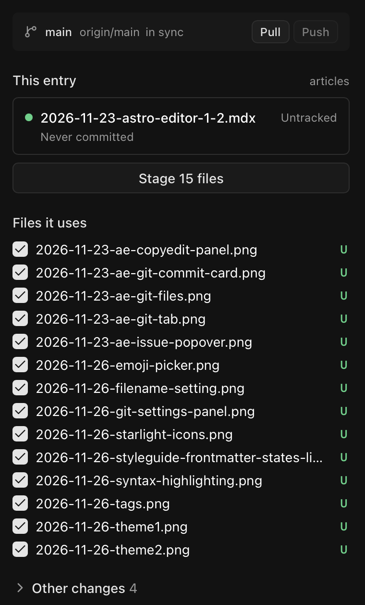
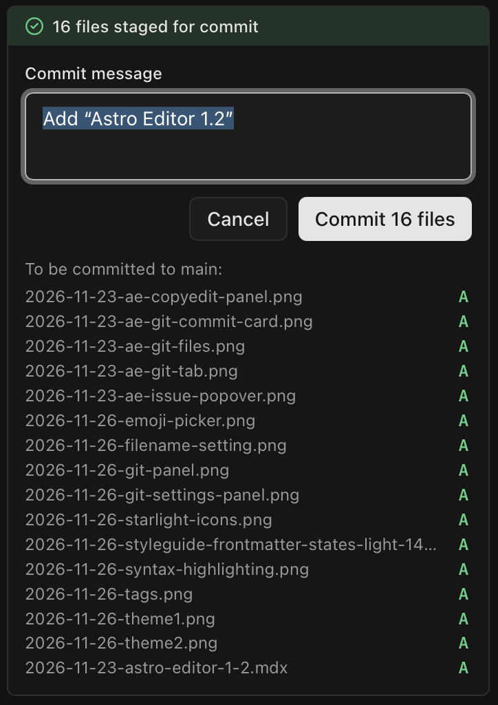
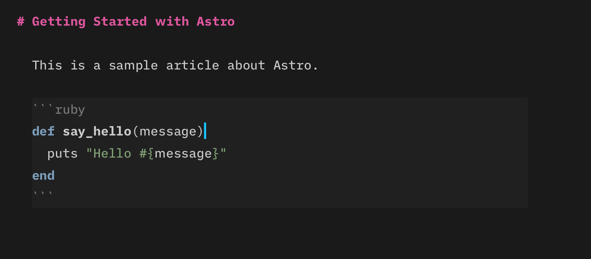
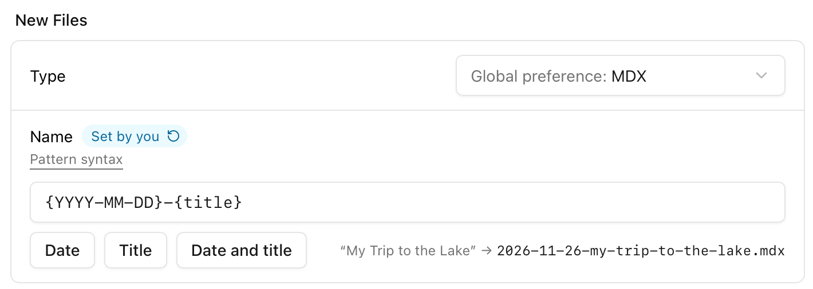
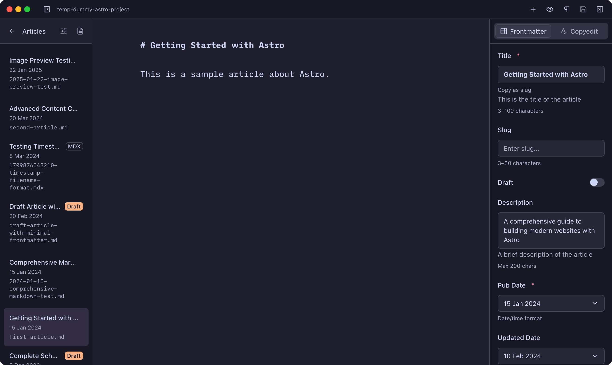
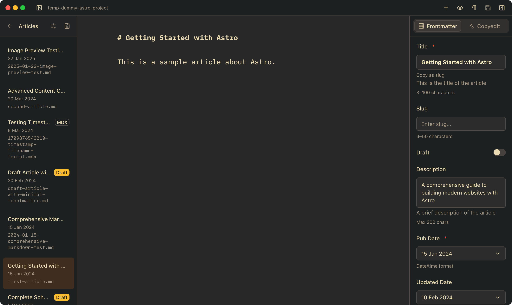

Hot on the heels of [Astro Editor 1.1](/writing/astro-editor-1-1), I've just shipped some fairly big new features in [version 1.2](https://astroeditor.danny.is/releases/v1.2.0/).

Astro Editor has always been about one thing: **providing the best possible environment for *writing* Astro content** and staying in the flow while doing so. Early versions were wholly focused on the design and UX of the editor itself and the frontmatter panel, with [focus mode](https://astroeditor.danny.is/editor/focus-and-typewriter/), [drag & drop image insertion](https://astroeditor.danny.is/editor/images-and-files/) and the [MDX component builder](https://astroeditor.danny.is/editor/mdx-components/) coming quickly after because they addressed my personal frustrations while **writing** content.

Resisting the urge to add more and more features has been fairly easy because I took the time to clearly define AE's [philosophy & core principles](https://astroeditor.danny.is/getting-started/philosophy/) from the start. They are:

1. Astro Editor is an interface for your content
2. Make Writer Mode easy
3. No coder-mode stuff
4. Simplicity

The order is intentional. My focus since releasing [1.0.0](/writing/introducing-astro-editor) a year ago has mostly been about the first one: ensuring AE is a reliable and predictable interface for working with your content. Much of the work in [1.1](/writing/astro-editor-1-1) was also in service of this.

Recent work to *Make Writer Mode Easy* has been limited to tiny tweaks and the MDX component builder. Because for me, AE already does this so well that nearly all the friction I experience when writing is to do with somewhat *coder mode* stuff. Hang on, lemme read that back 🤔...

> nearly all the friction I experience when writing is to do with somewhat coder mode stuff

If I'm writing prose in AE and I'm experiencing friction while doing so, *by definition* that's a writer-mode concern. Perhaps more fundamentally, **writer mode isn't limited to typing & tweaking frontmatter**.

AE 1.1 included [experimental auto-imports](/writing/astro-editor-1-1/#automatically-adding-imports) because it's normal to have a dev server running and your site open in a browser while you write – inserting an MDX component shouldn't interrupt you with a build error.

If Astro Editor is really gonna *make writer mode easy* it needs to help with the stuff that comes after we're done typing, because **that can still be writer mode stuff**. And so... Astro Editor 1.2 includes...

## The new Copyedit panel

The right sidebar now has a **Copyedit** tab where you can toggle the [highlights](https://astroeditor.danny.is/editor/copyediting/) for nouns, verbs, adjectives, adverbs and conjunctions.


It also includes new toggles for spelling, grammar and writing style, powered by [Harper](https://writewithharper.com) running locally on your machine. Switching these on shows any issues and their suggested fixes in the sidebar, and highlights them in the editor.


This is a very obvious example of something that has little to do with actually writing content but is still very much **writer mode**. I like to keep these switched off while I'm actually writing and then turn them on when I start reviewing and editing what I've written.

## The new Git panel

I've always considered any kind of git integration to be squarely in the *coder mode* box, philosophically. I'm also very conscious that git is inherently complicated and comes with an infinite number of potential edge cases to consider (monorepos, worktrees, submodules, merge conflicts, weird git configs & hooks, etc, etc).

But at the same time, it's *bloody annoying* that I have to open a terminal or VS Code after pretty much every session in Astro Editor. This is particularly annoying for me because:

1. I want all my unfinished drafts committed and pushed to GitHub whenever they change, even if I'm a long way from publishing them.
2. Most stuff in my [notes](/notes/) collection is ready to publish a few minutes after I've written it and that should be quick and easy to do.

In both cases I'm very much in *writer mode* and usually have no desire to run the site locally at all.

The new git features are built with this kind of use-case in mind. When you switch on the **[Git Panel](https://astroeditor.danny.is/git/)** in a project's settings, Astro Editor will check a bunch of stuff and show it to you like this, highlighting anything it reckons might cause problems:


With this set up, you'll see a new pane in the right sidebar.


The remote and current branch are shown at the top along with controls to pull and push. There's some [fairly complicated logic](https://astroeditor.danny.is/reference/git/) to ensure nothing gets messed up when pulling or pushing – if there's a chance of that happening, AE will refuse to do it.

Everything below that is concerned **only with helping you commit stuff related to the content item you currently have open**. The current entry's status is shown along with any images or files associated with it. Right now, this article is uncommitted and I've dragged a bunch of screenshots into it. Here's what that looks like in the git panel:



The current file is always *selected*, and images or assets it uses are checked by default but can be *deselected* by clicking the checkbox. The **Other changes** toggle shows any other uncommitted changes in the repo and allows you to check them if you want. Any images you've dragged into the current item and afterwards removed are shown in the **Files it uses** list, but are unchecked because you probably don't wanna commit them. That looks like this:


Clicking **Stage `n` files** will run `git add` on the content item itself and all the checked files and show a card like this where you can double-check what's going to be committed and write a commit message.



Clicking **Cancel** will close the card and unstage the files. Clicking **Commit** will actually make the commit.

After using this for a couple of weeks I'm pretty confident that this is an appropriate UI for *writer mode* git stuff. On a couple of occasions I've found myself needing to do something more fiddly/complex, and AE has correctly told me to go use a proper git tool to do that.

## Better frontmatter handling

I've also redesigned the frontmatter pane so it does a better job of showing any constraints imposed by the schema. It's not AE's job to *enforce* these constraints, but it now makes it clear when they're not met.


Under the hood, the entire frontmatter system has been rewritten. I've replaced the old YAML parser (`serde_norway`) with [serde-saphyr](https://crates.io/crates/serde-saphyr), configured to read YAML exactly as Astro's own `yaml` package does. I've also reworked how frontmatter blocks are found and written. Changed frontmatter values are now spliced into the existing YAML instead of the whole block being re-serialised, so editing a field changes only that field and fields now stay in the order you wrote them unless you turn on [Reorder frontmatter](https://astroeditor.danny.is/project-settings/#content) in the Project Settings.

You can read a bit more about this in the docs on [How YAML is handled](https://astroeditor.danny.is/reference/yaml/).

## Syntax highlighting

I've finally decided to add syntax highlighting for fenced code blocks because it just feels a bit nicer when you're reading over content. It's only on when your cursor is inside the block.



I still think actually *writing* code blocks should happen in a code editor.

## New file name patterns

In the [1.1 post](/writing/astro-editor-1-1) I said the file name pattern syntax was fairly simple and that *I'd end up allowing for more complex patterns in here sometime soon*. The collection-scoped setting now looks like this.



And for a post called *My Trip to the Lake*, created at 14:15 on 23 November 2026, you can now use [patterns](https://astroeditor.danny.is/project-settings/#file-names) like this:

```text
{YYYY-MM-DD}-{slug}        2026-11-23-my-trip-to-the-lake.md
{YYYY-MM-DD}-{shortSlug}   2026-11-23-trip-lake.md
{YYYYMMDDHHmm}-{slug}      202611231415-my-trip-to-the-lake.md
{X}                        1795443300.md
{index:2}-{slug}           03-my-trip-to-the-lake.md
```

- **Dates and times** use [Moment's tokens](https://momentjs.com/docs/#/displaying/format/).
- **`{slug}`** is a slugified version of the title; `{shortSlug}` also removes any filler words.
- **`{index}`** is one more than the highest number already in the folder (the `03` above assumes the folder already goes up to `02`).

## Custom colour themes

Astro Editor's UI has never been customisable beyond setting a custom heading colour and base font size. This is **very much intentional** – if you want a custom setup there are thousands of tools out there that are designed for just that.

I'm unlikely to change my position on this, but I've relented slightly when it comes to more advanced users. If you really want a [colour theme](https://astroeditor.danny.is/reference/advanced-preferences/#colour-themes) for AE you can drop a CSS file in `~/Library/Application Support/is.danny.astroeditor/themes` which looks something like this:

```css title="themes/nord.css"
:root {
  --background: light-dark(#e5e9f0, #292e39);
  --foreground: light-dark(#2e3440, #d8dee9);
  --editor-color-background: light-dark(#eceff4, #2e3440);
  --editor-color-text: light-dark(#2e3440, #d8dee9);
}
```

And it'll use the colours you've defined instead of the defaults.

<Grid>


</Grid>


## What else?

The latest releases include loads of little bugfixes and reliability improvements and a smattering of tiny quality-of-life features. You can see them all in the release notes.

<Callout title="Release Notes" type="default" emoji="📜">
- [Version 1.2.0](https://astroeditor.danny.is/releases/v1.2.0/)
- [Version 1.2.1](https://astroeditor.danny.is/releases/v1.2.1/)
</Callout>

For example... deleting a file now moves it to the OS trash, and there's a global setting for this. Plus...

<Grid columns={3}>


</Grid>


## Wrapping up

The Git panel is still marked experimental and off by default, and I'd really like to hear from anyone who switches it on – especially if AE refuses to do something you think it should, or does something it shouldn't. Bugs and ideas are very welcome in [GitHub issues](https://github.com/dannysmith/astro-editor/issues), and if you've not tried Astro Editor yet you can [download it here](https://astroeditor.danny.is/).


