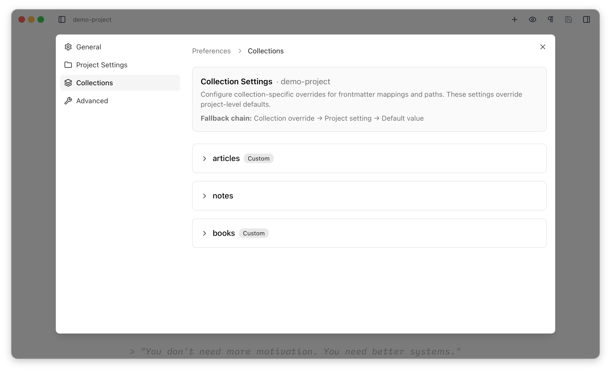
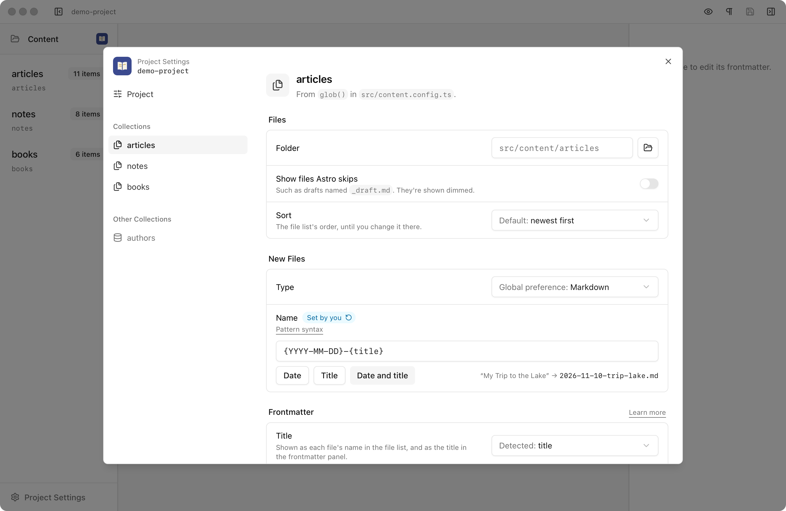
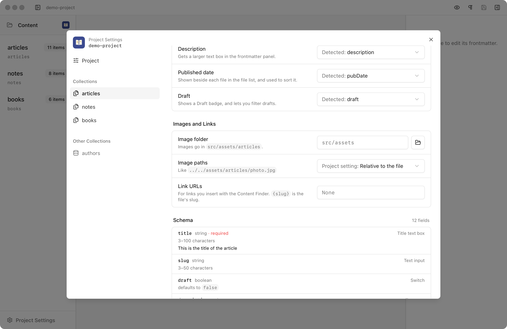
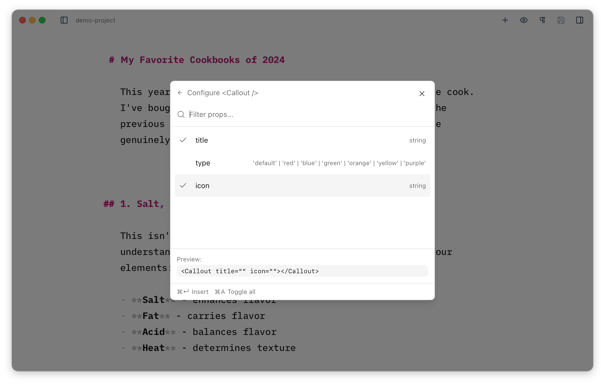
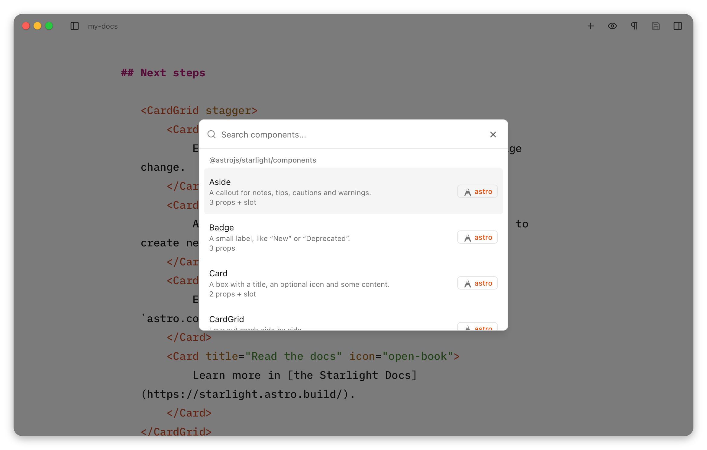
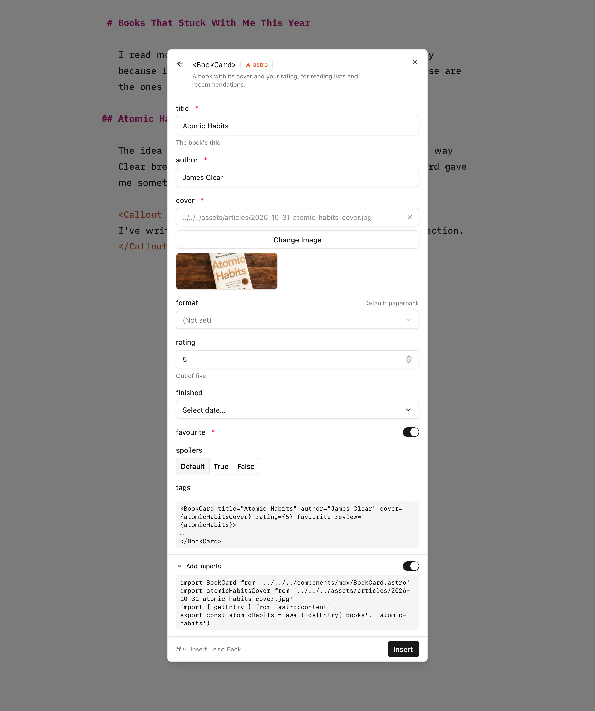

import releaseVideo from '@assets/notes/2026-11-10-astro-editor-1-1.mp4'
import releasePoster from '@assets/notes/2026-11-10-astro-editor-1-1-poster.jpg'

[Astro Editor 1.1.0]([DANNY: link to the GitHub release]) is out, and it's the biggest release since 1.0. It changes how the app understands your Astro project, turns the MDX component builder into a proper form, and can (if you want it to) write the imports your MDX files need. There's also a long list of fixes, which are all in the [release notes]([DANNY: link]).

<video src={releaseVideo} poster={releasePoster.src} controls playsinline preload="metadata" width="1920" height="1080"></video>

When I [launched Astro Editor](/writing/introducing-astro-editor) in January, the first thing on the roadmap was a [complete rework](https://github.com/dannysmith/astro-editor/issues/82) of how project settings work, along with a way to [control how new files are named](https://github.com/dannysmith/astro-editor/issues/87). By April it was the [only meaty thing left on the backlog](/notes/2026-04-02-slop-is-not-necessarily-the). Both are in this release.

One thing to know before you upgrade: **settings from 1.0 aren't carried over**. Each project starts with none the first time you open it (the old settings file is kept, renamed to `<project-id>.v2.json`). For most sites that's fine, because Astro Editor now reads most of what it used to ask you for. [DANNY: whether any of your own sites needed setting up again after the prerelease]

## Project settings

### How it worked before

Astro Editor 1.0 assumed every collection lived in `src/content/<collection-name>`. If your site was set up differently, you told it so in two tabs in Preferences, with overrides for the project and again for each collection. Each setting fell back through a chain: collection override, then project setting, then default.



That was fine for sites laid out the way Astro's docs suggest, but it didn't hold up well beyond them. A collection whose files lived somewhere else simply didn't appear, with no explanation. Nothing showed what Astro Editor had guessed, so you couldn't tell a value it had worked out from one you'd set. Projects were matched by the `name` in their `package.json`, so two copies of the same site shared settings. And the collection-level folder override was saved but never actually used.

[DANNY: what pushed you to rework it. #81 was a stripped-back site from the Astro Discord that it couldn't read at all.]

### The mental model

The idea behind the rework is that Astro Editor should **read your project rather than ask you about it**. Your content config already says where each collection's files are and what its frontmatter looks like, so the app should use that, and only ask about the things it can't know.

So there are two kinds of setting:

1. **What Astro says.** Read from your project every time it's scanned, and never stored. That's each collection's folder and file pattern (from its loader) and which fields are its title, date, description and draft (from its schema).
2. **What you chose.** Stored only when you change something, and only on your computer. Nothing is written into your project.

Everything about a site lives in Project Settings. Preferences are now just about you and how you like to write: theme, font size, auto-save and your IDE.

Reading loaders properly fixes the "unusual structure" problem. Astro Editor now reads `glob()` the way Astro does, including its `base` and `pattern`, so a config like this works:

```ts title="src/content.config.ts"
const blog = defineCollection({
  loader: glob({ base: './content/blog', pattern: '**/[^_]*.md' }),
  schema: z.object({
    // ...
  }),
})
```

Astro Editor 1.0 would have looked for `src/content/blog`, not found it, and left the collection out. Now it finds `content/blog`, and files the pattern leaves out (like `_draft.md`) are hidden, or shown dimmed if you'd rather see them. Starlight's `docsLoader()` and legacy collections work too.

### Project Settings

[Project Settings](https://astroeditor.danny.is/project-settings/) is its own window now, opened from the bottom of the file list. Rather than a form full of empty overrides, it shows what Astro Editor found: where each collection comes from, its folder, how new files are named and which frontmatter fields it uses for what.



Every value says where it came from. **Detected: `title`** means it found a field of the right name and type in the schema. **Default** and **Global preference** mean what they say. Once you change something it's marked **Set by you**, with a button to reset it. So you can see what's been worked out and what's been chosen, and you only change what it got wrong.

Each collection's page also shows its schema as Astro Editor reads it, with how the frontmatter panel will show each field. Problems show up here and in the file list, like a folder that doesn't exist or a schema that needs `astro sync`, along with what to do about them. In 1.0 those only ever made it into the logs.



### A project list and file names

Two smaller things came along with this. <kbd>⇧⌘O</kbd> opens a [list of every project](https://astroeditor.danny.is/file-management/overview/#opening-a-project) you've opened, with each site's favicon. Projects are remembered by their folder now, so one you've moved shows as **Missing** until you point it at the new location.

[DANNY: screenshot of the project list, to take from the dev app]

And each collection can [name new files](https://astroeditor.danny.is/project-settings/#file-names) with a pattern like `{YYYY-MM-DD}-{title}` or just `{title}`. A new file gets a name as soon as it's created, and is renamed once you've written its title.

## The MDX component builder

### How it worked before

Press <kbd>⌘/</kbd> in an MDX file and you get a list of the components in your MDX folder. In 1.0, picking one showed its props and their types, which you could toggle on and off, and it then inserted the tag with every prop empty.



You then filled in the values by hand, in the editor, which meant knowing what each one accepted and how to write it in MDX. For a `Callout` with a title that's easy. For a component that takes an image, a date or one of a set of options, it usually meant opening the component's code to check.

[DANNY: why you wanted to change it]

### How it works now

Picking a component now gives you a form, with a field for each prop built from its type. Here's a component from the [docs](https://astroeditor.danny.is/editor/mdx-components/):

```astro title="src/components/mdx/BookCard.astro"
---
/**
 * A book with its cover and your rating, for reading lists and recommendations.
 */
import type { ImageMetadata } from 'astro'
import type { CollectionEntry } from 'astro:content'

interface Props {
  /** The book's title */
  title: string
  author: string
  cover: ImageMetadata
  format?: 'hardback' | 'paperback' | 'ebook' | 'audiobook'
  /** Out of five */
  rating?: number
  finished?: Date
  favourite: boolean
  spoilers?: boolean
  tags?: string[]
  /** Your full review, linked from the card */
  review?: CollectionEntry<'books'>
}

const { format = 'paperback' } = Astro.props
---
```

And here's the form it gets:


Strings get text boxes, unions of strings become dropdowns, and numbers, dates, booleans and lists get the controls you'd expect. Anything it can't work out gets a text box. Doc comments become help text, defaults are shown beside each prop, and required props are marked. The builder also writes each value in the right MDX syntax (`rating={5}`, `finished={new Date('2026-01-15')}`), so you don't have to remember it.

It reads props from Astro, React, Vue and Svelte components, straight from their source, without running your project. And if your site uses [Starlight](https://starlight.astro.build/), the builder offers Starlight's own components too, like `Tabs`, `Card` and `Steps`, with their contents filled in.



## Adding imports

Every component used in an MDX file has to be imported at the top, between the frontmatter and the content. Astro Editor hides those lines while you write, and until now it never touched them. So after inserting a component you had to add its import in a code editor, or the page would break. The 1.0 docs suggested [astro-auto-import](https://github.com/delucis/astro-auto-import) as a workaround, which is [what I use on this site](/notes/less-painful-editing-in-astro).

In 1.1 the builder can [add the imports for you](https://astroeditor.danny.is/editor/mdx-components/#adding-imports). This is the first feature that edges Astro Editor towards "coder mode" (it writes code in your project, even if you never see it), so it's careful. The imports it writes should be good enough that you never need to fix them, and when it isn't sure what to write, it leaves the file alone. It's off by default and marked experimental: turn on **Add imports** in Project Settings to use it.

With it on, the builder adds the component's import when it inserts the tag. It copies how your other MDX files already import that component, so aliases like `@components/mdx` and index files get used without Astro Editor having to understand your `tsconfig.json`. If nothing imports it yet, it uses a relative path. Quotes and semicolons match the rest of the file, and nothing else in those lines changes.

It also means props that need something imported get proper pickers. An image prop gets an image picker, which copies the image into your project and imports it. A prop that takes a collection entry gets a searchable list of that collection's entries, loaded with `getEntry`. Filling in that `BookCard` form…



…puts this in the file:

```mdx title="books-that-stuck.mdx"
import BookCard from '../../../components/mdx/BookCard.astro'
import atomicHabitsCover from '../../../assets/articles/2026-10-31-atomic-habits-cover.jpg'
import { getEntry } from 'astro:content'
export const atomicHabits = await getEntry('books', 'atomic-habits')

<BookCard title="Atomic Habits" author="James Clear" cover={atomicHabitsCover} rating={5} favourite review={atomicHabits}>
  ...
</BookCard>
```

Leave it off if your site uses astro-auto-import or something like it, because a component imported twice breaks the build (Astro Editor warns you if `astro-auto-import` is in your `package.json`). That's why it's off for this site. I mostly built it for other people, but some of my other docs sites don't use the auto-importer, so I'll be turning it on there.

## Other bits

A few smaller things in 1.1.0 worth a mention:

- **Quitting saves your work**, however you quit, and asks before quitting if the save fails.
- **Opening a project takes you back to the file you had open** when you last left it.
- **New files no longer get frontmatter that fails your build.** Required fields used to be filled with `""` or `0`, which looked filled in but could fail your site's build. Now they're left for you to fill in.
- **Undoing a frontmatter edit leaves the file exactly as it was**, formatting and all.
- **The file list notices changes made outside the app**, so files added, changed or deleted elsewhere show up straight away.
- **Zod 4 schemas** with tuples, literals, unions and nullable objects no longer stop a collection's schema from loading.
- **Reference fields write the ids Astro uses** (`first-article`), not Astro Editor's own (`articles/first-article`).
- **Windows no longer crashes on launch.**

And a couple from the last few point releases: Astro 7 support, and dates in the file list shown with month names so they can't be misread (and no longer a day early if you're west of UTC).

[DANNY: a closing line if you want one, e.g. what's next or how it's been on your own sites]
